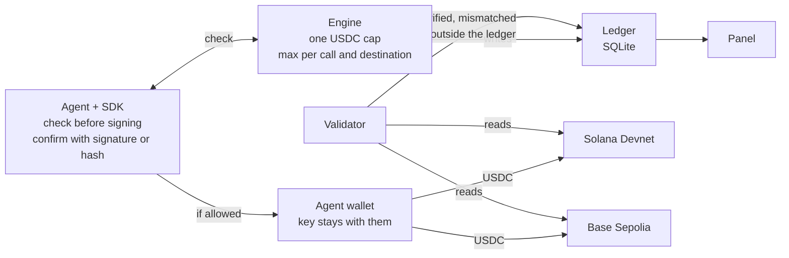
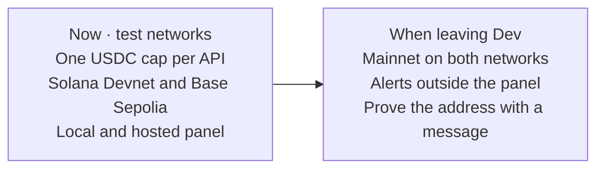

# PRD v2 — Agent Spend Control

11/10/2026 · Lorena Samuel

One USDC cap per API. Each agent is one company (Nansen, Vybe, TCG, and the ones that follow). Solana and Base are not spend types: they only confirm that USDC left the right wallet, for the right amount, to the address the API asked for.

This version runs on test networks: **Solana devnet** and **Base Sepolia**. USDC on those networks has no real value.

## What changed on 11/10/2026

The 06/10 version treated four payment rails (AI models, x402, Solana transfer, and subscription) as four caps on the same agent. That is gone. The product is now spend control for APIs paid per call in USDC.

| Change | Why |
| --- | --- |
| One agent, one API, one cap | The panel answers how much that API spent, not four mixed categories |
| Solana and Base are the settlement networks | The same USDC can settle on either; both count toward the same cap |
| The 402 address enters the rule and the check | The app refuses, before signing, a destination that is not the API’s, then confirms USDC landed there |
| Two public wallets per agent | One base58 on Solana, one `0x` on Base. The private key stays outside the app |
| Test networks as the default | Everything in this version uses devnet and Sepolia |
| AI, free transfer, and subscription left the MVP | There is no Solana transaction on a card invoice; promising on-chain proof there was false |

## Problem and vision

People who pay APIs per call in USDC cannot see, in one place, how much each vendor has already consumed, and have no proof that the panel number is the USDC that left.

- **Per-call spend:** Nansen, Vybe, TCG, x402engine, and other APIs charge USDC via x402. There is no subscription or API key: payment is access.
- **Two networks, one balance that does not mix:** the same call costs the same dollar on Solana or Base, but USDC on one does not pay the other.
- **Control on the payer side:** x402 dashboards show seller revenue.
- **Number without proof:** if the agent declares the amount and skips the SDK, the cap lies.

**Vision:** a layer on the payer side. Before signing, the engine decides whether that USDC may leave. Afterward, the network confirms amount, wallet, and recipient.

**Value proposition:** see, limit, and prove the USDC spent with each API, without holding the wallet key.

## Goals and metrics

The MVP proves you can see, limit, and verify the test USDC agents spend on APIs, on Solana devnet and Base Sepolia.

**Goals**

1. One cap per agent, in USDC, per day or per month.
2. Decide before signing: allow, alert, block, ask for approval, or pause the agent.
3. Verify on the network where USDC left, and mark mismatch or off-ledger spend.
4. Sum both networks into the same cap.

**Non-goals**

- Hold funds or private keys.
- Connect Phantom or Coinbase Wallet. The panel does not sign. *(Hosted prep for Phantom on Devnet may build an unsigned tx; signing still stays in the wallet.)*
- Pay the API on behalf of the agent.
- Verify a card invoice, OpenAI, or Claude. That spend never touches Solana or Base.
- Run on mainnet in this version. Mainnet exists as an `.env` option and stays off.

**Success metrics**

| Metric | MVP target |
| --- | --- |
| Payments with signature or hash verified at the source | 100% within 1 min after confirmation |
| USDC that left watched wallets without a request | Detected in the scan |
| Rule-check latency | < 50 ms (p95) |
| Time to first cap | < 15 min after signup |

## Users and stories

| Persona | Who they are | What they need |
| --- | --- | --- |
| Agent developer | Calls x402 APIs with the agent wallet | A cap before signing and proof afterward |
| Tech lead | Sees several vendors | Which API spent, on which network, and what was blocked |

**Stories**

- As a developer, I want one agent per API and a daily USDC cap so a loop cannot empty the test wallet.
- As a developer, I want to pass the address the API asked for in the 402 so the app blocks another destination before signing.
- As a developer, I want to paste only the Phantom public address on Devnet and the Base Sepolia `0x`.
- As a tech lead, I want Solana and Base on the same cap and in the ledger’s network column.
- As a tech lead, I want to be notified when USDC leaves without going through the engine.

## Functional requirements

| ID | Requirement | In MVP |
| --- | --- | --- |
| RF-01 | Register an agent with name, description, Solana address, and Base address | Yes |
| RF-02 | One USDC cap per agent, per day or per month | Yes |
| RF-03 | Check before paying: network (`solana` or `base`), amount, vendor, and destination | Yes |
| RF-04 | The most restrictive rule wins (cap, max per call, destination, approval, pause) | Yes |
| RF-05 | Max per call, list of API receiving addresses, and approval above an amount | Yes |
| RF-06 | Pause the agent when the 100% rule says so | Yes |
| RF-07 | Ledger every attempt, allowed or not | Yes |
| RF-08 | Verify on Solana by signature and on Base by hash, including the recipient | Yes, on Devnet and Sepolia |
| RF-09 | Scan both wallets and mark USDC that left without a request | Yes |
| RF-10 | If the on-chain amount differs, the ledger uses the network amount | Yes |
| RF-11 | Alerts at 50%, 80%, and 100%, and on mismatch or off-ledger spend | Yes, in the panel |
| RF-12 | Panel: one cap, chart by network, approvals, validation, ledger, and phone tabs | Yes |
| RF-13 | Refuse private key, JSON keypair, 12/24-word phrase, and 32-byte hex `0x` key | Yes |
| RF-14 | Presentation round that records decisions and does not pay | Yes |
| RF-15 | Alerts by email, Slack, and webhook | No |
| RF-16 | Prove the address by signing a message, without the key leaving the wallet | No |
| RF-17 | Mainnet as a usage mode | No. Only if `SOLANA_NETWORK` or `BASE_NETWORK` are changed |

## Policy model

Each agent has one rule: period, USDC cap, max per call, and the addresses that API receives on. Solana and Base do not have separate caps.

Actions, from loosest to strictest: `permitir` (allow) < `alertar` (alert) < `trocar_modelo` (switch model) < `pedir_aprovacao` (ask approval) < `bloquear` (block) = `pausar_agente` (pause agent). `trocar_modelo` remains in the engine and is unused in the examples.

```yaml
agent: nansen
solana_wallet: <public Devnet address>
base_wallet: <0x address on Sepolia>
rule:
  period: day
  cap_usd: 1
  per_call_max_usd: 0.05
  destinations: [<API Solana payTo>, <API Base payTo>]
  at_80pct: alert
  at_100pct: pause_agent
```

`check` sends `network`, `amount`, `vendor`, and `destination`. A destination off the list is blocked before signing. What counts toward the cap is what left: allowed plus off-ledger, at the network amount when there is a mismatch.

Seed examples: nansen ($1/day, max $0.05), vybe ($0.50, max $0.03), tcg ($0.40, max $0.05). `npm run seed` wipes the demo ledger and recreates these three.

## Source validation

| Status | Meaning |
| --- | --- |
| Verified | The network confirms amount, recipient, and success |
| Pending | The signature or hash is not on the RPC yet |
| Mismatched | The network confirms another amount, another recipient, or a failed tx |
| Outside the ledger | USDC left a watched wallet without a `check` |

**Solana.** `getTransaction` with the configured commitment (`finalized` by default). Test USDC mint `4zMMC9srt5Ri5X14GAgXhaHii3GnPAEERYPJgZJDncDU` left the agent wallet for the declared amount to the requested destination. The scan uses `getSignaturesForAddress`.

**Base.** `eth_getTransactionReceipt` against Circle’s Sepolia test USDC, `0x036CbD53842c5426634e7929541eC2318f3dCF7e`. The `Transfer` event must leave the agent’s `0x` wallet for the requested destination. The scan uses `eth_getLogs` on recent blocks; if the RPC rejects the range, the window shrinks.

Blocked rows have nothing to verify: the wallet never signed.

Validation is read-only. It needs the RPC URL and public addresses. Panel login (`PANEL_TOKEN`) is a separate secret from `AGENT_TOKEN` and the wallets.

## Architecture



If the agent skips the SDK and pays from the wallet, the scan still finds the outflow and adds it to the cap. The app does not stop signing on-chain: it stops the decision to sign, and reports what left anyway.

## Non-functional requirements and security

| Area | Requirement |
| --- | --- |
| Latency | Rule check < 50 ms at p95 |
| Custody | Never hold funds or keys |
| Wallet fields | Refuse secrets and do not store them |
| RPC | URL and key only in `.env`; the panel shows at most the last 4 characters |
| Access | `AGENT_TOKEN` for the SDK; `PANEL_TOKEN` for the panel, required when the host is not localhost |
| Audit | Cap changes go to `rule_audit` |
| Ledger | Signature or hash is unique |
| Privacy | Do not store the call body — only amount, network, destination, and vendor |

## MVP scope

Runs locally on Node 22.13+ (tested on 24). Code lives in `mvp/`. Hosted panel also deploys on Vercel.

| Piece | Status |
| --- | --- |
| SDK `check` / `confirm` | Done |
| One cap, max per call, destinations, approval, pause | Done |
| SQLite ledger | Done |
| Solana Devnet and Base Sepolia validators | Done |
| Panel, dry-run simulation, presentation round, phone tabs ≤ 700 px | Done |
| Day/night theme, hosted live agent, Phantom Devnet prepare | Done |
| Wallet login as custody, mainnet as default usage, external alerts | Out of scope |

**How it was verified (11/10/2026)**

- Tests for rules, key refusal, Solana and Base validators with mocked RPC, and end-to-end API.
- Local bring-up: Solana Devnet and Base Sepolia answered on public RPC. Example-wallet scans finished without error.

**How to run**

```bash
cd mvp
cp .env.example .env
npm run seed
npm start
```

Panel at `http://127.0.0.1:8787`. Below 700 px width, the bottom bar opens Home, Agents, Approvals, Ledger, and More (Protection / Admin). Hosted access: see [access-manual.md](./access-manual.md).

**Known limits**

- On localhost the panel does not ask for login. Off-machine it requires `PANEL_TOKEN`; LAN use is plain HTTP.
- Only test USDC is recognized, one contract per network.
- The Base scan looks at recent blocks, not the full history.
- Days and months follow the server clock; the chart groups by UTC day.
- Seed addresses are not a Phantom wallet. Verification of a person’s wallet starts when the public address is saved in Protection.
- Production x402 APIs settle mainnet USDC. They do not accept test-network USDC.

## Roadmap



Proving the address means connecting the wallet and signing a message. The key stays in Phantom or the Base wallet. That does not pay the API and does not replace `PANEL_TOKEN`.

## Risks

| Risk | What the MVP does |
| --- | --- |
| Agent pays without `check` | The scan marks outside the ledger and adds to the cap. It does not undo the payment |
| Slow or rate-limited RPC | The row stays pending; Base shrinks the block range if the node refuses |
| Someone pastes a key | The field refuses and warns to move the funds |
| Paying on the wrong network | A Base hash is not read on Solana, and the reverse. The network goes in `check` |
