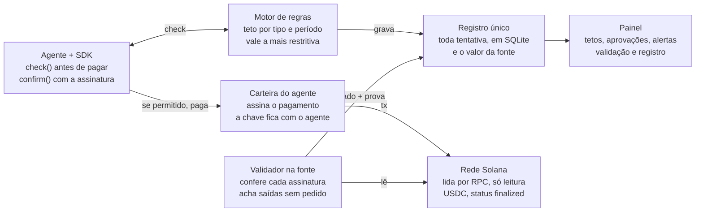
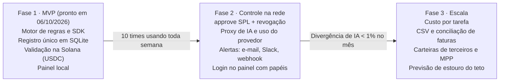

# PRD v2 — Agent Spend Control

06/10/2026 · Lorena Samuel · versão viva: https://claude.ai/code/artifact/abc882a7-a1d5-480b-b924-a900139e3be8

Um registro único do que cada agente de IA gasta em todos os meios de pagamento, com teto automático por tipo de pagamento e validação de cada gasto na fonte.

## O que mudou desde a v1

A revisão do protótipo trouxe uma mudança central: o registro deixa de confiar só no que o agente declara e passa a conferir cada gasto na fonte.

| Mudança | Por quê | Onde |
| --- | --- | --- |
| Validação na fonte de cada gasto | O SDK pode errar ou ser contornado; a rede, o recibo x402 e o provedor de IA são a verdade | Validação na fonte |
| Detecção de pagamentos fora do registro | Um agente pode pagar direto da carteira sem passar pelo motor de regras | Validação na fonte |
| Valor da fonte vence divergência | Os tetos precisam ser calculados sobre o gasto real, não o declarado | Modelo de políticas |
| Conexão Solana só de leitura | Basta um RPC e o endereço público; o produto nunca pede chave privada e recusa uma colada por engano | Segurança |
| Correção: o `approve` do token SPL não tem validade | A v1 prometia allowance nativa "com teto e validade"; a validade passa a ser uma revogação agendada pelo serviço ou uma carteira com políticas | Arquitetura |
| MVP construído | Motor de regras, registro, validação real na devnet e painel rodando localmente | Escopo do MVP |

## Problema e visão

Quem roda agentes de IA não sabe quanto eles gastam, não consegue impor um teto por tipo de pagamento e não tem como provar que o número no painel é o gasto real.

- **Gasto espalhado:** o mesmo agente paga modelos de IA por fatura, APIs por chamada via x402 e transferências na Solana. Cada fornecedor mostra só o próprio pedaço.
- **Controle do lado errado:** as ferramentas de x402 mostram receita para quem vende. Quem paga não tem painel equivalente.
- **Limites isolados:** carteiras limitam só a própria carteira; gateways de IA limitam só os modelos.
- **Número sem prova:** um registro alimentado só pelo SDK do agente diverge da fatura e não enxerga pagamentos que contornaram as regras.

**Visão:** uma camada neutra, do lado de quem paga, que junta todos os gastos num registro só, aplica tetos por tipo de pagamento antes de o dinheiro sair e confere cada gasto na fonte depois.

**Proposta de valor:** "veja, limite e prove" o gasto de todos os seus agentes num painel só, sem entregar a custódia dos fundos.

## Objetivos e métricas

O MVP deve provar que um time consegue ver, limitar e conferir 100% do gasto on-chain dos seus agentes num painel só.

**Objetivos**

1. Somar o gasto de cada agente entre todos os tipos de pagamento, em tempo quase real.
2. Aplicar um teto por agente, tipo de pagamento e período, e decidir antes de o dinheiro sair.
3. Conferir cada pagamento na fonte e marcar o que diverge ou saiu sem passar pelo motor.
4. Mostrar o custo por tarefa concluída, não só o total (fase 2).

**Não-objetivos (MVP)**

- Guardar fundos ou chaves privadas de clientes.
- Ser carteira, meio de pagamento ou emissor de cartão.
- Rastrear a origem do dinheiro (análise forense).

**Métricas de sucesso**

| Métrica | Meta no MVP |
| --- | --- |
| Pagamentos on-chain conferidos na fonte | 100% em até 1 min após a confirmação |
| Pagamentos fora do registro detectados | 100% dos que saíram das carteiras vigiadas |
| Divergência entre painel e fatura de IA | < 1% no fechamento do mês |
| Latência adicionada por checagem de regra | < 50 ms (p95) |
| Tempo até o primeiro teto configurado | < 15 min após o cadastro |
| Times usando toda semana | 10 times em 8 semanas |

As metas são hipóteses iniciais, para validar com os primeiros clientes.

## Usuários e histórias

O primeiro usuário é o desenvolvedor que já roda agentes pagando APIs; o segundo é quem responde pelo orçamento.

| Persona | Quem é | O que precisa |
| --- | --- | --- |
| Dev de agentes | Constrói agentes com MCP, x402 e APIs de modelos | Integrar em minutos e não tomar susto na conta |
| Líder técnico | Responsável por vários agentes em produção | Ver qual agente gasta mais e por quê |
| Financeiro | Aprova orçamento e fecha o mês | Um teto por categoria e um número que bate com as faturas |

**Histórias**

- Como dev, quero ligar meu agente com uma chamada de SDK para ver todo gasto dele num lugar só.
- Como dev, quero um teto de US$ 20 por dia em x402 para que um loop não esvazie a carteira.
- Como dev, quero informar só o endereço público da carteira do agente para que o painel confira as transações na rede.
- Como líder técnico, quero ser avisado quando sair dinheiro da carteira sem passar pelo motor de regras.
- Como líder técnico, quero que o agente troque para um modelo mais barato ao chegar a 80% do teto.
- Como financeiro, quero aprovar pagamentos acima de US$ 100 antes que saiam.
- Como financeiro, quero ver as divergências entre o registro e a fonte antes de fechar o mês.

## Requisitos funcionais

P0 entra no MVP; a coluna "No MVP construído" diz o que já roda no código desta versão.

| ID | Requisito | Prioridade | No MVP construído |
| --- | --- | --- | --- |
| RF-01 | Cadastrar agentes com nome, descrição e carteira pública | P0 | Sim |
| RF-02 | Criar tetos por agente, tipo de pagamento e período (dia, mês) | P0 | Sim |
| RF-03 | Checar cada pagamento antes de sair: permitir, bloquear ou pedir aprovação | P0 | Sim (API) |
| RF-04 | Valer a regra mais restritiva quando várias se aplicam | P0 | Sim |
| RF-05 | Máximo por transação, lista de destinos permitidos e aprovação acima de um valor | P0 | Sim |
| RF-06 | Pausar o agente automaticamente quando a regra mandar | P0 | Sim |
| RF-07 | Registro único de cada tentativa, permitida ou não | P0 | Sim |
| RF-08 | Validar transferências e pagamentos x402 na Solana pela assinatura da transação | P0 | Sim (devnet e mainnet) |
| RF-09 | Varrer a carteira do agente e marcar pagamentos fora do registro | P0 | Sim |
| RF-10 | Usar o valor da fonte quando ele divergir do declarado | P0 | Sim |
| RF-11 | Alertas em 50%, 80% e 100% do teto, e em divergências | P0 | Sim (no painel) |
| RF-12 | Painel com gasto por agente e tipo, tetos, aprovações, validação e registro | P0 | Sim |
| RF-13 | Recusar chave privada ou frase de recuperação em qualquer campo | P0 | Sim |
| RF-14 | Proxy compatível com OpenAI para medir e cortar gasto com modelos de IA | P1 | Não |
| RF-15 | Conferir o gasto de IA na API de uso do provedor | P1 | Não |
| RF-16 | Alertas por e-mail, Slack e webhook | P1 | Não |
| RF-17 | Trocar para modelo mais barato perto do teto | P1 | Não (só a decisão) |
| RF-18 | Teto aplicado na rede com `approve` + revogação agendada | P1 | Não |
| RF-19 | Custo por tarefa marcado pelo SDK | P1 | Não |
| RF-20 | Exportar CSV e conciliar com faturas | P2 | Não |

## Modelo de políticas

Toda regra combina agente, tipo de pagamento, período, teto e ação; quando várias regras se aplicam, vale a mais restritiva.

| Tipo de pagamento | Exemplos | Onde o bloqueio acontece | Onde é conferido |
| --- | --- | --- | --- |
| Modelos de IA | OpenAI, Anthropic, OpenRouter | Proxy corta a chamada ou a chave | API de uso do provedor |
| API por chamada (x402) | APIs de dados, servidores MCP pagos | SDK recusa antes de assinar | Transação na rede + recibo x402 |
| Transferência Solana | USDC para endereços | SDK recusa; na fase 2, `approve` com revogação | Transação na rede |
| Assinatura recorrente | Planos mensais de SaaS | Só monitora no MVP | Fatura do fornecedor |

Ações em ordem de rigor: `permitir` < `alertar` < `trocar_modelo` < `pedir_aprovacao` < `bloquear` = `pausar_agente`.

```yaml
agente: pesquisa-mercado
carteira: 7xKX...p9Qe        # endereço público, nunca a chave privada
regras:
  - tipo: modelos_ia
    periodo: mes
    teto_usd: 500
    em_80pct: trocar_modelo
    em_100pct: bloquear
  - tipo: x402
    periodo: dia
    teto_usd: 20
    por_transacao_max_usd: 0.50
    em_100pct: pausar_agente
  - tipo: solana_transfer
    periodo: mes
    teto_usd: 1500
    destinos_permitidos: ["<endereco-fornecedor>"]
    aprovacao_acima_de_usd: 100
```

O gasto que conta para o teto é o que de fato saiu: pagamentos permitidos mais os que saíram fora do registro, sempre pelo valor da fonte.

## Validação na fonte

Cada pagamento que movimentou dinheiro é conferido na fonte e recebe um de quatro estados; o painel mostra a contagem de cada um e a prova de cada linha.

| Estado | Significa | O que o painel faz |
| --- | --- | --- |
| Conferido | A fonte confirma valor, destino e status | Mostra a prova (assinatura, slot, fonte) |
| Aguardando | A fonte ainda não confirmou | Tenta de novo; on-chain fica aguardando se o RPC cair |
| Divergente | A fonte confirma, mas o valor difere do declarado | Alerta e passa a usar o valor da fonte |
| Fora do registro | Saiu da carteira sem nenhum pedido no motor | Alerta crítico e soma ao gasto do agente |

**Checagens por tipo**

- **Solana e x402:** a assinatura existe no RPC; o status é `finalized` (ou `confirmed`, configurável); a transação mexeu no saldo de USDC da carteira do agente no valor declarado; o recebedor bate com o destino pedido.
- **Modelos de IA (fase 2):** o custo calculado pelo proxy bate com a API de uso do provedor, com tolerância de 1%.
- **Assinaturas (fase 2):** a fatura bate com o valor monitorado.
- **Barrados:** confirma que nenhuma transação saiu.

**Pagamentos fora do registro:** o validador lista as assinaturas recentes da carteira (`getSignaturesForAddress`), descarta as que já estão no registro e lê as demais (`getTransaction`). Toda saída de USDC sem pedido correspondente vira uma linha "Fora do registro".

A validação só lê a rede: precisa de uma URL de RPC e do endereço público de cada carteira, nunca da chave privada.

## Arquitetura

O agente pergunta ao motor antes de pagar e informa a assinatura depois; o validador lê a rede e marca cada linha do registro como conferida, divergente ou fora do registro.



O motor e o validador são independentes: se o agente pular o SDK e pagar direto da carteira, o validador ainda acha a saída na rede e a soma ao gasto. Na fase 2, um `approve` do token SPL com revogação agendada passa a impedir esse caso antes, na própria rede.

## Requisitos não funcionais e segurança

O produto fica no caminho de cada pagamento e guarda um registro financeiro, então velocidade, disponibilidade e segurança vêm antes de funcionalidade.

| Área | Requisito |
| --- | --- |
| Latência | Checagem de regra < 50 ms no p95 |
| Disponibilidade | 99,9% no motor de regras; se cair, bloqueia acima de um valor mínimo e libera os pequenos |
| Custódia | Nunca guardar fundos nem chaves privadas dos agentes |
| Chave privada | Qualquer campo recusa chave privada, keypair em JSON ou frase de 12/24 palavras, sem gravar nada |
| Chave do RPC | Guardada só no servidor (variável de ambiente); a interface mostra no máximo os 4 últimos caracteres |
| Acesso à API | O SDK do agente usa um token próprio; o painel usa outro, separado |
| Auditoria | Toda mudança de regra fica registrada com autor, data, valor anterior e novo |
| Registro | Linhas nunca são apagadas; correções da validação guardam o valor declarado e o da fonte |
| Consistência | Sem gasto duplicado: a assinatura da transação é única no registro |
| Privacidade | Não guardar o conteúdo dos prompts, só metadados de custo |

## Escopo do MVP

O MVP está construído e roda localmente sem nenhuma dependência além do Node 22.13+: motor de regras, registro, validação real na Solana e painel. O código está em `Documentos/Nectrae/mvp`.

| Parte | O que faz | Estado |
| --- | --- | --- |
| SDK do agente | `check` antes de pagar, `confirm` com a assinatura depois | Pronto |
| Motor de regras | Teto por agente, tipo e período; máximo por transação; destinos permitidos; aprovação; pausa | Pronto |
| Registro único | SQLite embutido no Node; toda tentativa gravada; auditoria de regras | Pronto |
| Validador Solana | Confere a assinatura via RPC; varre carteiras atrás de saídas fora do registro; tenta de novo após limite de chamadas (429) | Pronto |
| Painel | Tetos, simulação sem gravar, aprovações, alertas, validação, conexão Solana, registro com prova | Pronto |
| Proxy de IA, alertas externos, `approve` na rede | Fase 2 | Fora do MVP |

**Como foi verificado (06/10/2026)**

- 34 testes automáticos passando: regras, recusa de chave privada, validador com respostas de RPC simuladas e a API de ponta a ponta.
- Na devnet real: conexão (slot 508.223.924, 146 ms), varredura de carteira e uma transferência real de 1 USDC conferida em todas as checagens.
- O RPC público da devnet devolveu 429 (limite de chamadas) na primeira varredura; o cliente agora espera e tenta de novo.

**Como rodar**

```bash
cp .env.example .env
npm run seed
npm start
```

O painel abre em `http://127.0.0.1:8787`; `npm run demo` faz um agente de exemplo chamar o SDK.

**Limites conhecidos do MVP**

- Painel sem login: só responde em localhost (ou com `PANEL_TOKEN`).
- Só USDC é reconhecido na validação.
- Dias e meses seguem o relógio do servidor; o gráfico agrupa por dia UTC.
- Gasto com IA e assinaturas é registrado e limitado, mas ainda não conferido na fonte.

## Roadmap

A fase 1 está pronta; a fase 2 começa quando o MVP tiver 10 times usando toda semana e leva o teto para dentro da rede.



Os portões vêm das métricas de sucesso; nenhuma fase tem data definida além da conclusão do MVP.

## Riscos e perguntas em aberto

O maior risco é o agente contornar o SDK; a validação na fonte detecta isso depois, mas só o teto aplicado na rede impede antes.

| Risco | Impacto | Mitigação |
| --- | --- | --- |
| Agente paga sem passar pelo SDK | Teto vira só alerta | Validação marca "fora do registro"; fase 2 aplica `approve` com teto na rede |
| `approve` do SPL não expira | Permissão esquecida continua valendo | Revogação agendada pelo serviço, ou carteira com políticas (Squads) |
| RPC fora do ar ou com limite | Pagamentos ficam "Aguardando" | Provedor pago, RPC reserva e nova tentativa com espera |
| Preço do modelo de IA muda | Divergência com a fatura | Tabela de preços versionada e conferência na API de uso |
| Motor de regras cai | Agentes travados ou soltos | Regra de falha definida por valor mínimo |
| Alguém cola chave privada | Vazamento de fundos | Recusa no campo e aviso para mover os fundos |

**Perguntas em aberto**

- [ ] Status mínimo para "Conferido": `confirmed` (mais rápido) ou `finalized` (mais seguro)?
- [ ] Além de USDC, quais tokens o MVP deve reconhecer?
- [ ] O primeiro cliente usa x402 na Solana ou na Base?
- [ ] Preço: por agente, por volume conferido ou plano fixo?
- [ ] Validar a carteira por varredura periódica ou por webhook do provedor de RPC?
