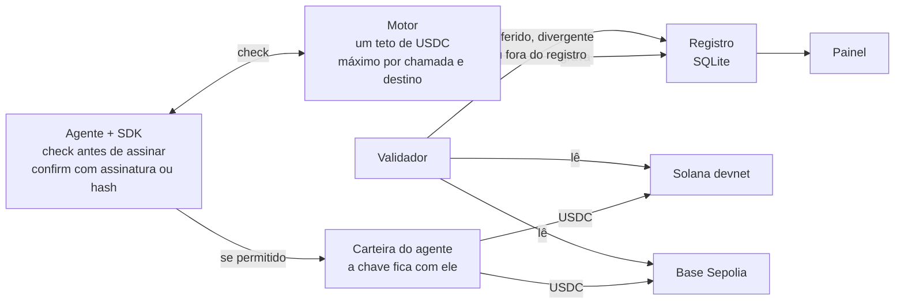
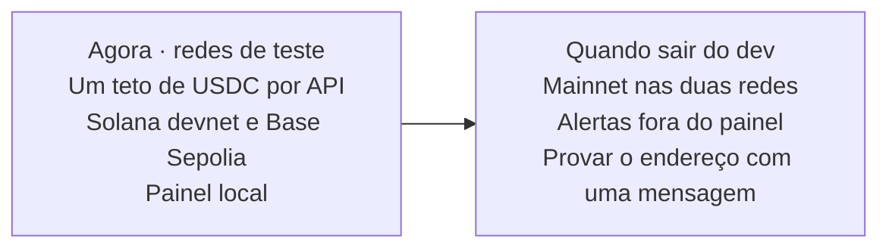

# PRD v2 — Agent Spend Control

11/10/2026 · Lorena Samuel

Um teto de USDC por API. Cada agente é uma empresa (Nansen, Vybe, TCG e as próximas). A Solana e a Base não são tipos de gasto: só conferem se o USDC saiu da carteira certa, no valor certo, para o endereço que a API pediu.

O uso desta versão é em rede de teste: **Solana devnet** e **Base Sepolia**. O USDC dessas redes não tem valor.

## O que mudou em 11/10/2026

A versão de 06/10 tratava quatro meios de pagamento (modelos de IA, x402, transferência Solana e assinatura) como quatro tetos no mesmo agente. Isso saiu. O produto passou a ser controle de gasto com APIs pagas por chamada em USDC.

| Mudança | Por quê |
| --- | --- |
| Um agente, uma API, um teto | O painel responde quanto aquela API gastou, não quatro categorias misturadas |
| Solana e Base são a rede da conferência | O mesmo USDC pode liquidar numa ou na outra; as duas somam no mesmo teto |
| O endereço do 402 entra na regra e na conferência | O app recusa, antes de assinar, um destino que não é o da API, e depois confere se o USDC caiu lá |
| Duas carteiras públicas por agente | Uma base58 na Solana, uma `0x` na Base. Chave privada continua fora do app |
| Redes de teste como padrão | Tudo o que esta versão usa é devnet e Sepolia |
| IA, transferência livre e assinatura saíram do MVP | Não há transação na Solana numa fatura de cartão; prometer conferência ali era falso |

## Problema e visão

Quem paga APIs por chamada em USDC não vê, num lugar só, quanto cada fornecedor já consumiu, e não tem prova de que o número do painel é o USDC que saiu.

- **Gasto por chamada:** Nansen, Vybe, TCG, x402engine e outras APIs cobram USDC via x402. Não há mensalidade nem chave de API: o pagamento é o acesso.
- **Duas redes, um saldo que não se mistura:** a mesma chamada custa o mesmo dólar na Solana ou na Base, mas o USDC de uma não paga a outra.
- **Controle do lado de quem paga:** os painéis de x402 mostram a receita de quem vende.
- **Número sem prova:** se o agente declarar o valor e pular o SDK, o teto mente.

**Visão:** uma camada do lado de quem paga. Antes da assinatura, o motor decide se aquele USDC pode sair. Depois, a rede confirma valor, carteira e recebedor.

**Proposta de valor:** ver, limitar e provar o USDC gasto com cada API, sem guardar a chave da carteira.

## Objetivos e métricas

O MVP prova que dá para ver, limitar e conferir o USDC de teste que os agentes gastam em APIs, na Solana devnet e na Base Sepolia.

**Objetivos**

1. Um teto por agente, em USDC, no dia ou no mês.
2. Decidir antes de assinar: permitir, alertar, bloquear, pedir aprovação ou pausar o agente.
3. Conferir na rede em que o USDC saiu, e marcar divergência ou saída sem pedido.
4. Somar as duas redes no mesmo teto.

**Não-objetivos**

- Guardar fundos ou chaves privadas.
- Conectar Phantom ou Coinbase Wallet. O painel não assina.
- Pagar a API no lugar do agente.
- Conferir fatura de cartão, OpenAI ou Claude. Esse gasto não passa pela Solana nem pela Base.
- Rodar em mainnet nesta versão. Mainnet existe como opção no `.env` e fica desligada.

**Métricas de sucesso**

| Métrica | Meta no MVP |
| --- | --- |
| Pagamentos com assinatura ou hash conferidos na fonte | 100% em até 1 min após a confirmação |
| USDC que saiu das carteiras vigiadas sem pedido | Detectado na varredura |
| Latência da checagem de regra | < 50 ms (p95) |
| Tempo até o primeiro teto | < 15 min após o cadastro |

## Usuários e histórias

| Persona | Quem é | O que precisa |
| --- | --- | --- |
| Dev de agentes | Chama APIs x402 com a carteira do agente | Um teto antes de assinar e a prova depois |
| Líder técnico | Vê vários fornecedores | Qual API gastou, em qual rede, e o que foi barrado |

**Histórias**

- Como dev, quero um agente por API e um teto diário em USDC para um loop não esvaziar a carteira de teste.
- Como dev, quero informar o endereço que a API pediu no 402 para o app barrar outro destino antes da assinatura.
- Como dev, quero colar só o endereço público da Phantom em devnet e o `0x` da Base Sepolia.
- Como líder técnico, quero ver Solana e Base no mesmo teto e na coluna de rede do registro.
- Como líder técnico, quero ser avisado quando sair USDC sem passar pelo motor.

## Requisitos funcionais

| ID | Requisito | No MVP |
| --- | --- | --- |
| RF-01 | Cadastrar agente com nome, descrição, endereço Solana e endereço Base | Sim |
| RF-02 | Um teto de USDC por agente, por dia ou por mês | Sim |
| RF-03 | Checar antes de pagar: rede (`solana` ou `base`), valor, fornecedor e destino | Sim |
| RF-04 | Vale a regra mais restritiva (teto, máximo por chamada, destino, aprovação, pausa) | Sim |
| RF-05 | Máximo por chamada, lista dos endereços da API e aprovação acima de um valor | Sim |
| RF-06 | Pausar o agente quando a regra de 100% mandar | Sim |
| RF-07 | Registro de cada tentativa, permitida ou não | Sim |
| RF-08 | Conferir na Solana pela assinatura e na Base pelo hash, inclusive o recebedor | Sim, em devnet e Sepolia |
| RF-09 | Varrer as duas carteiras e marcar USDC que saiu sem pedido | Sim |
| RF-10 | Se o valor da rede divergir, o registro passa a usar o da rede | Sim |
| RF-11 | Alertas em 50%, 80% e 100%, e em divergência ou saída sem pedido | Sim, no painel |
| RF-12 | Painel: um teto, gráfico por rede, aprovações, validação, registro e abas de celular | Sim |
| RF-13 | Recusar chave privada, keypair JSON, frase de 12/24 palavras e chave hex `0x` de 32 bytes | Sim |
| RF-14 | Rodada de apresentação que grava decisões e não paga | Sim |
| RF-15 | Alertas por e-mail, Slack e webhook | Não |
| RF-16 | Provar o endereço assinando uma mensagem, sem a chave sair da carteira | Não |
| RF-17 | Mainnet como modo de uso | Não. Só se `SOLANA_NETWORK` ou `BASE_NETWORK` forem trocados |

## Modelo de políticas

Cada agente tem uma regra: período, teto em USDC, máximo por chamada e os endereços em que aquela API recebe. Solana e Base não têm teto próprio.

Ações, da mais frouxa à mais rígida: `permitir` < `alertar` < `trocar_modelo` < `pedir_aprovacao` < `bloquear` = `pausar_agente`. `trocar_modelo` continua no motor e não é usado nos exemplos.

```yaml
agente: nansen
carteira_solana: <endereço público em devnet>
carteira_base: <endereço 0x em Sepolia>
regra:
  periodo: dia
  teto_usd: 1
  por_chamada_max_usd: 0.05
  destinos: [<payTo Solana da API>, <payTo Base da API>]
  em_80pct: alertar
  em_100pct: pausar_agente
```

O `check` manda `network`, `amount`, `vendor` e `destination`. Destino fora da lista é barrado antes de assinar. O que conta no teto é o que saiu: permitido mais fora do registro, no valor da rede quando houver divergência.

Exemplos no seed: nansen (US$ 1/dia, máx. US$ 0,05), vybe (US$ 0,50, máx. US$ 0,03), tcg (US$ 0,40, máx. US$ 0,05). `npm run seed` apaga o registro de demonstração e recria esses três.

## Validação na fonte

| Estado | Significa |
| --- | --- |
| Conferido | A rede confirma valor, recebedor e sucesso |
| Aguardando | A assinatura ou o hash ainda não aparece no RPC |
| Divergente | A rede confirma outro valor, outro recebedor, ou a transação falhou |
| Fora do registro | Saiu USDC da carteira vigiada sem um `check` |

**Solana.** `getTransaction` com o status configurado (`finalized` por padrão). Saiu USDC do mint de teste `4zMMC9srt5Ri5X14GAgXhaHii3GnPAEERYPJgZJDncDU` da carteira do agente, no valor declarado, para o destino pedido. A varredura usa `getSignaturesForAddress`.

**Base.** `eth_getTransactionReceipt` no USDC de teste da Circle em Sepolia, `0x036CbD53842c5426634e7929541eC2318f3dCF7e`. O evento `Transfer` precisa sair da carteira `0x` do agente para o destino pedido. A varredura usa `eth_getLogs` nos blocos recentes; se o RPC recusar a faixa, a janela encolhe.

Barrado não tem o que conferir: a carteira não chegou a assinar.

A validação só lê. Precisa da URL de RPC e dos endereços públicos. O login do painel (`PANEL_TOKEN`) é outro segredo, separado do `AGENT_TOKEN` e das carteiras.

## Arquitetura



Se o agente pular o SDK e pagar da carteira, a varredura ainda acha a saída e soma no teto. O app não impede a assinatura na rede: impede a decisão de assinar, e denuncia o que saiu mesmo assim.

## Requisitos não funcionais e segurança

| Área | Requisito |
| --- | --- |
| Latência | Checagem de regra < 50 ms no p95 |
| Custódia | Nunca guardar fundos nem chaves |
| Campos de carteira | Recusam segredo e não gravam |
| RPC | URL e chave só no `.env`; o painel mostra no máximo os 4 últimos caracteres |
| Acesso | `AGENT_TOKEN` no SDK; `PANEL_TOKEN` no painel, obrigatório se o host não for localhost |
| Auditoria | Mudança de teto fica em `rule_audit` |
| Registro | A assinatura ou o hash é único |
| Privacidade | Não guardar o corpo da chamada, só valor, rede, destino e fornecedor |

## Escopo do MVP

Roda localmente com Node 22.13+ (testado no 24), sem dependências. Código em `mvp/`.

| Parte | Estado |
| --- | --- |
| SDK `check` / `confirm` | Pronto |
| Um teto, máximo por chamada, destinos, aprovação, pausa | Pronto |
| Registro SQLite | Pronto |
| Validador Solana devnet e Base Sepolia | Pronto |
| Painel, simulação sem gravar, rodada de apresentação, abas de celular até 700 px | Pronto |
| Login de carteira, mainnet como uso, alertas externos | Fora |

**Como foi verificado (11/10/2026)**

- 40 testes: regras, recusa de chave, validadores Solana e Base com RPC simulado, e a API de ponta a ponta.
- Subida local: Solana devnet e Base Sepolia responderam no RPC público. A varredura das carteiras de exemplo fechou sem erro.

**Como rodar**

```bash
cd mvp
cp .env.example .env
npm run seed
npm start
```

Painel em `http://127.0.0.1:8787`. Abaixo de 700 px de largura, a barra de baixo abre Início, Agentes, Aprovações, Registro e Proteção.

**Limites conhecidos**

- O painel em localhost não pede login. Fora da máquina, exige `PANEL_TOKEN` e a conexão é HTTP.
- Só USDC de teste é reconhecido, um contrato por rede.
- A varredura da Base olha blocos recentes, não o histórico inteiro.
- Dias e meses seguem o relógio do servidor; o gráfico agrupa por dia UTC.
- Os endereços criados pelo seed não são uma Phantom. A conferência na carteira da pessoa começa quando o endereço público entra em Proteção.
- APIs x402 de produção liquidam USDC de mainnet. Elas não aceitam o USDC destas redes de teste.

## Roadmap



Provar o endereço é conectar a carteira e assinar uma mensagem. A chave continua na Phantom ou na carteira da Base. Isso não paga a API e não substitui o `PANEL_TOKEN`.

## Riscos

| Risco | O que o MVP faz |
| --- | --- |
| O agente paga sem `check` | A varredura marca fora do registro e soma no teto. Não desfaz o pagamento |
| RPC lento ou com limite | A linha fica aguardando; a Base encolhe a faixa de blocos se o nó recusar |
| Alguém cola a chave | O campo recusa e avisa para mover os fundos |
| Pagar na rede errada | O hash da Base não é lido na Solana, e o contrário também. A rede vai no `check` |
